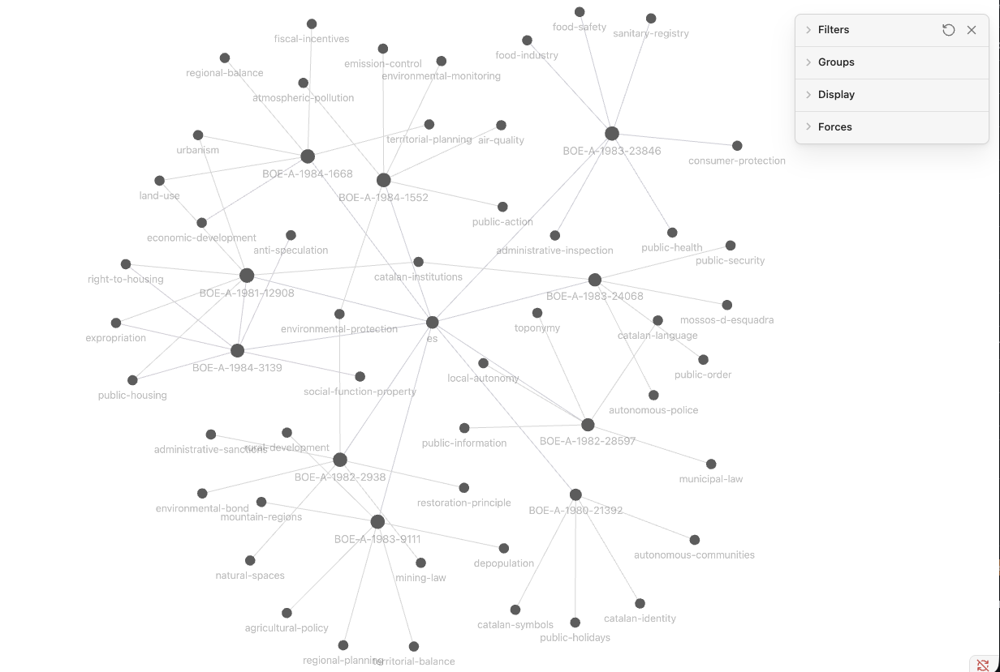

<div align="center">


</div>

<div align="center">

**English** · [Español](README.es.md)

[](https://opensource.org/licenses/MIT)
[](https://www.python.org/downloads/)
[](https://github.com/astral-sh/uv)
[](https://claude.ai/code)

A legal knowledge base that actually cites the source text.

[Slash Commands](#slash-commands) • [Architecture](#architecture) • [Adding Countries](#adding-a-new-country) • [Tracking](#tracking) • [Issues](https://github.com/arnabdeypolimi/your-ai-lawyer/issues)

</div>

---

Official country laws sit in git submodules. Claude Code reads them, writes a summary + wikilink graph into `knowledge/`, and a local ChromaDB index lets you search or ask questions with citations back to the real article. No separate API key: the model work runs through your Claude Code session, and the embeddings and search index stay on your machine.

Spain is wired up (12,000+ laws from the BOE). 27 more countries are one `git submodule add` away.

<div align="center">



*The first 10 Cataluña laws in the Obsidian graph view. `BOE-A-*` nodes are laws; the smaller nodes are shared concept pages they link to.*

</div>

---


## What you get

- Run `/compile es-ct --limit 10` and Claude reads ten Cataluña laws, writes summaries, extracts concepts, and wires up wikilinks.
- Output is a valid Obsidian vault. Open it in Obsidian and the graph is there.
- Two ChromaDB collections: one for the compiled summaries, one for raw article chunks. Queries hit both.
- `/qa` answers in prose with `[BOE-A-XXXX-XXXXX, Art. N]` citations. You can click through to the original.
- Recompiles skip files that haven't changed (md5 hash check). Every run is logged.
- `/lint` flags orphans, broken wikilinks, and untracked notes.

### What runs where

- **Stays on your machine:** the raw laws, the compiled notes, the embeddings (a local ONNX model) and the ChromaDB index.
- **Goes to Anthropic through Claude Code:** the law text `/compile` reads, your `/qa` and `/search` queries along with the passages they pull up, and the text of any contract you pass to `/review-contract` or `/contract-qa`. Whatever data terms apply to your Claude Code account apply here.

If you want a search with no model in the loop, run it directly: `uv run python -m src.query.search "right to housing" --country es`.

---

## Quick Start

### Install

```bash
git clone --recurse-submodules https://github.com/arnabdeypolimi/your-ai-lawyer.git
cd your-ai-lawyer
uv sync
```

Requires [uv](https://github.com/astral-sh/uv) and [Claude Code](https://claude.ai/code).

### Open in Claude Code

```bash
claude .
```

### Pick a language (once)

```bash
/setup            # interactive
/setup es         # direct
```

Built-in: `en`, `es`, `ca`, `fr`, `it`, `de`, `pt`. Any other BCP-47 code works too, it just goes straight to the model.

The choice lives in `.claude/settings.json` as `env.OUTPUT_LANGUAGE`. New `/compile` runs and `/qa` answers pick it up immediately. Existing notes stay in whatever language they were compiled in, which is deliberate — change the setting, run `/compile <jurisdiction> --force`, and you'll rewrite them.

### Compile some laws

Start small. Cataluña with a limit of 10 is a good smoke test:

```bash
/compile es-ct --limit 10
```

Then scale up. Constitutional-only is ~50 files; all of Spain is 12k+ and you'll want to run it in batches of a few hundred:

```bash
/compile es --rank constitucion
/compile es
```

### Build the search index

```bash
/index
/index --country es --compiled-only
```

### Ask it something

```bash
/qa What are the housing rights of tenants in Spain?
/qa Does Cataluña have its own data protection laws?
/search right to education --country es --n 10
```

### Review a contract

```bash
/review-contract ~/Downloads/lease.pdf
/contract-qa ~/Downloads/lease.pdf Can the landlord keep the whole deposit?
```

You get `lease.reviewed.pdf` next to the original. Clauses that conflict with a law in the knowledge base are highlighted: red for high confidence, orange for medium, yellow for low. Each highlight carries a comment with the citation, and a note on page 1 lists missing terms, topics the knowledge base does not cover, and pages that could not be read. The original file is never changed. Review data is kept in `lease.review/` so you can ask questions later.

It only knows the laws in your index. A contract with few highlights is not necessarily a sound contract; check the "not covered" list. Text PDFs only: scanned pages are skipped. This is not legal advice.

### Sanity check

```bash
/lint
/lint --jurisdiction es-ct
/lint --broken-links
```

---

## Slash Commands

| Command | Description |
|---------|-------------|
| `/setup [<language-code>]` | Pick output language for compiled notes + `/qa` |
| `/compile <jurisdiction> [--limit N] [--rank R] [--force]` | Compile raw laws into knowledge graph |
| `/index [--country X] [--compiled-only] [--raw-only]` | Build / update ChromaDB vector index |
| `/search <query> [--country X] [--rank R] [--n N]` | Semantic search with ranked results |
| `/qa <question>` | RAG answer with inline citations |
| `/lint [--jurisdiction X] [--broken-links]` | Health check on knowledge base |
| `/review-contract <pdf> [--country X] [--force]` | Check a contract PDF against the laws; returns a highlighted copy |
| `/contract-qa <pdf> <question>` | Ask follow-up questions about a reviewed contract |

Spain's regional codes: `es` for national, plus `es-ct`, `es-md`, `es-an`, `es-pv`, `es-ga`, `es-vc`, `es-ib`, `es-ar`, `es-cn`, `es-cl`, `es-cm`, `es-cb`, `es-as`, `es-ri`, `es-nc`, `es-mc` for the 17 autonomous communities.

---

## Architecture

```
your-ai-lawyer/
├── legalize-es/              # Spain raw laws (git submodule, 12K+ files)
├── knowledge/                # Compiled Obsidian vault
│   ├── laws/es/              # One .md per law: summary, provisions, wikilinks
│   ├── concepts/             # Concept index files with backlinks
│   └── jurisdictions/        # Per-country overview notes
├── data/
│   ├── index.json            # Per-law compilation status
│   ├── compile.log           # Run history (NDJSON)
│   ├── manifest.json         # MD5 hashes for change detection
│   └── chroma/               # ChromaDB vector store (gitignored)
└── src/
    ├── compiler/             # parser, extractor, batch, tracker, lint
    ├── contract/             # Contract review: extract passages, validate findings, annotate PDF
    ├── indexer/              # ChromaDB embedding pipeline
    └── query/                # Semantic search
```

### Compilation pipeline

```
legalize-<country>/
  raw markdown + YAML frontmatter
          │
          ▼  /compile (Claude Code reads + writes directly)
          │   list_files.py  →  lists files needing compilation
          │   tracker.py     →  records result in index.json + compile.log
          │
knowledge/laws/<country>/
  compiled notes with [[wikilinks]]
          │
          ▼  /index (local ONNX embeddings — no API key)
          │
data/chroma/
  compiled collection + raw_chunks collection
          │
          ▼  /qa or /search
  citations: [BOE-A-XXXX-XXXXX, Art. N]
```

### What a compiled note looks like

Every `knowledge/laws/es/<identifier>.md` starts with YAML frontmatter:

```yaml
---
identifier: BOE-A-1978-31229
title: "Constitución Española"
country: es
jurisdiction: es
rank: constitucion
status: in_force
compiled_at: 2026-04-21
---
```

Then a summary, key provisions (bullets), cross-references as wikilinks, any supersedes/implements relationships, concept tags, and a path back to the raw source. `knowledge/` is a valid Obsidian vault — point Obsidian at it and the graph is there.

---

## Tracking

Three files in `data/` track compilation state:

| File | Contents |
|------|---------|
| `manifest.json` | `{ raw_path: md5_hash }` — skips unchanged files on recompile |
| `index.json` | Per-law record: `status`, `compiled_at`, `note_path`, `error` |
| `compile.log` | NDJSON run history: timestamp, jurisdiction, counts, error IDs |

Check status directly:

```bash
uv run python -m src.compiler.tracker status
uv run python -m src.compiler.tracker status --jurisdiction es-ct
uv run python -m src.compiler.tracker log --n 20
```

---

## Adding a New Country

All the raw legislation comes from [legalize-dev](https://github.com/legalize-dev) — one repo per country, Markdown + YAML frontmatter, maintained independently.

Replace `XX` with a country code below and run:

```bash
git submodule add https://github.com/legalize-dev/legalize-XX.git legalize-XX
git submodule update --init legalize-XX
claude .
/compile XX --limit 20
/index --country XX
/qa What are the employment rights in France?
```

For the big ones (US has 60k+ sections, Portugal 109k+ norms), don't try to compile everything at once. Do it in batches by legal rank, and keep an eye on the tracker:

```bash
/compile us --rank statute --limit 50
/compile pt --rank lei --limit 50
uv run python -m src.compiler.tracker status --jurisdiction us
```

---

## Available Countries

28 countries. Pick one, submodule it, compile. Spain is the only one wired up in this repo so far — everything else is a `git submodule add` away.

| Country | Code | Submodule | Laws | Source |
|---------|------|-----------|------|--------|
| 🇦🇩 Andorra | `ad` | `legalize-ad` | — | BOPA |
| 🇦🇷 Argentina | `ar` | `legalize-ar` | — | Infoleg |
| 🇦🇹 Austria | `at` | `legalize-at` | — | RIS |
| 🇧🇪 Belgium | `be` | `legalize-be` | — | Justel |
| 🇨🇱 Chile | `cl` | `legalize-cl` | — | BCN / Ley Chile |
| 🇨🇿 Czech Republic | `cz` | `legalize-cz` | — | ⚠️ Under development |
| 🇩🇰 Denmark | `dk` | `legalize-dk` | — | retsinformation.dk |
| 🇪🇪 Estonia | `ee` | `legalize-ee` | — | Riigi Teataja |
| 🇫🇮 Finland | `fi` | `legalize-fi` | — | Finlex |
| 🇫🇷 France | `fr` | `legalize-fr` | — | Légifrance |
| 🇩🇪 Germany | `de` | `legalize-de` | — | gesetze-im-internet.de |
| 🇬🇷 Greece | `gr` | `legalize-gr` | — | ΦΕΚ Α' |
| 🇮🇪 Ireland | `ie` | `legalize-ie` | — | legislation.ie |
| 🇮🇹 Italy | `it` | `legalize-it` | — | Normattiva |
| 🇰🇷 South Korea | `kr` | `legalize-kr` | — | 국가법령정보센터 |
| 🇱🇻 Latvia | `lv` | `legalize-lv` | — | likumi.lv |
| 🇱🇹 Lithuania | `lt` | `legalize-lt` | — | TAR / data.gov.lt |
| 🇱🇺 Luxembourg | `lu` | `legalize-lu` | — | legilux.lu |
| 🇳🇱 Netherlands | `nl` | `legalize-nl` | — | Basis Wetten Bestand |
| 🇳🇴 Norway | `no` | `legalize-no` | — | Lovdata (NLOD 2.0) |
| 🇵🇱 Poland | `pl` | `legalize-pl` | — | Sejm / Dziennik Ustaw |
| 🇵🇹 Portugal | `pt` | `legalize-pt` | 109K+ | Diário da República |
| 🇸🇰 Slovakia | `sk` | `legalize-sk` | — | Slov-Lex |
| 🇪🇸 Spain | `es` | `legalize-es` ✅ | 12K+ | BOE |
| 🇸🇪 Sweden | `se` | `legalize-se` | — | riksdagen.se |
| 🇺🇦 Ukraine | `ua` | `legalize-ua` | — | Verkhovna Rada |
| 🇬🇧 United Kingdom | `gb` | — | — | Coming soon |
| 🇺🇸 United States | `us` | `legalize-us` | 60K+ | US Code |
| 🇺🇾 Uruguay | `uy` | `legalize-uy` | — | IMPO |

✅ = already added as submodule · ⚠️ = under active development, structure may change

---

## Contributing

Issue first, PR second. Most useful contributions right now: adding a new country submodule, tightening the compile prompts, improving the linter, or writing a better extractor for a specific legal rank.

## Acknowledgements

None of this works without [legalize-dev](https://github.com/legalize-dev). They scrape, clean, and version the raw government publications into Markdown; this repo just compiles a graph on top. Each country submodule is maintained over there under its own license.

## Terms of Use

This is not legal advice. I'm not a lawyer. The compiled summaries and Q&A answers are generated by a language model from publicly available government sources, which can be outdated or incomplete, and the model can be wrong. If you're making a decision that matters, talk to an actual lawyer and verify against the original source the citations point to.

By using this you accept that:
- The maintainers aren't liable for anything that goes wrong
- Laws change. Compiled notes are a snapshot, not the current state
- The law texts come with their own reuse conditions (see License). If you redistribute them or build something commercial on top, meeting those is on you

## License

MIT for the code: use it, change it, ship it, commercially or not.

That license does not cover the law texts. They live in the legalize-dev submodules, each under its own terms. Spain's (`legalize-es`) follows the BOE reuse conditions, which require citing the source. Check the submodule's `LICENSE` before you reuse the text. The compiled notes in `knowledge/` are derived from those texts; each one keeps its `source` link.
